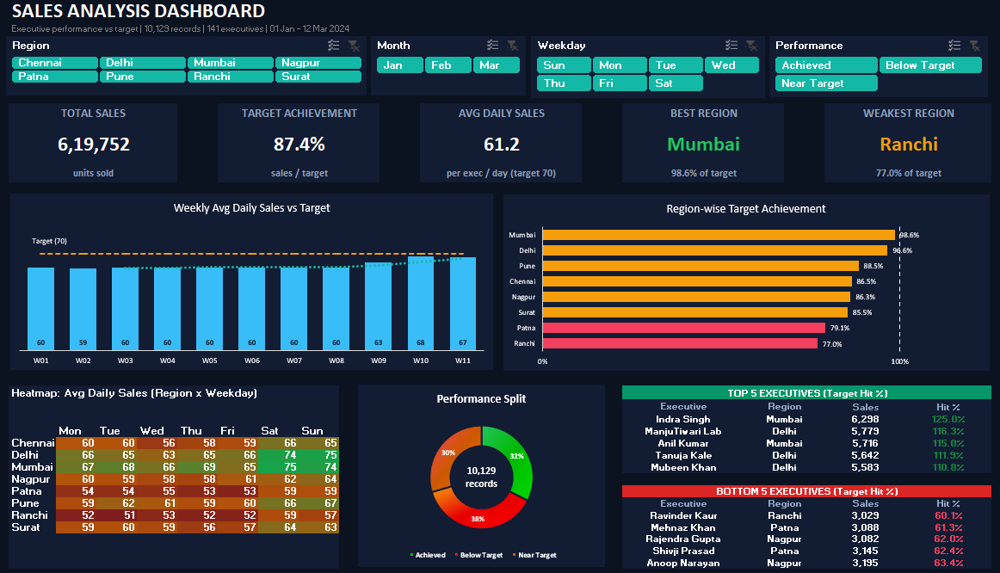
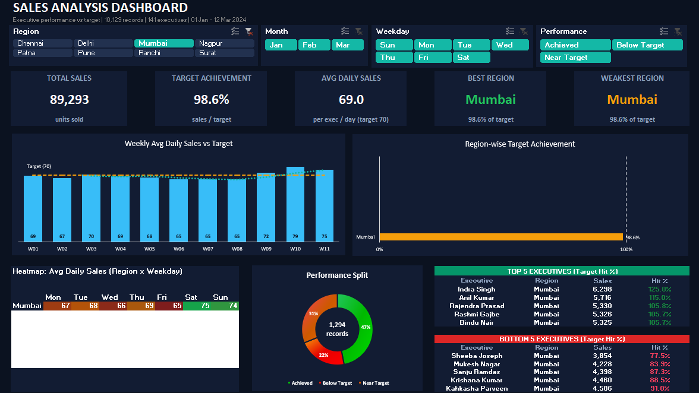

# Sales Performance & Target Achievement Analysis (Excel)

An interactive Excel dashboard that tracks sales executive performance against targets, with slicers, KPI cards, charts and a region x weekday heatmap.





## Dashboard features
- **5 KPI cards:** Total Sales, Target Achievement, Avg Daily Sales, Best Region, Weakest Region
- **4 slicers:** Region, Month, Weekday, Performance. One click updates every visual
- **Weekly Avg Daily Sales vs Target** chart with a 3-week moving average
- **Region-wise Target Achievement** chart (green / amber / red by performance band)
- **Heatmap:** Avg Daily Sales by Region x Weekday
- **Performance split:** Achieved / Near Target / Below Target
- **Top 5 and Bottom 5 executives** by Target Hit %

## Key insights
- Overall target achievement is **87.4%**; **38%** of executive-days finished below 80% of target
- **Mumbai** is the best region (98.6% of target), **Ranchi** the weakest (77.0%)
- Sales on weekends run roughly **11% higher** than on weekdays
- Weekly average daily sales stay near 60 until week 9, then rise to 68 by week 10

## Data
10,129 daily sales records for 141 sales executives across 8 regions (01 Jan 2024 to 12 Mar 2024).
Daily target: 70 units per executive.

> This is a **synthetic practice dataset** created for learning. It is not real company data.

| File | Description |
|---|---|
| `data/raw_data.csv` | Source data before cleaning |
| `data/cleaned_data.csv` | Data after cleaning and adding calculated columns |

## Process
1. Loaded the raw data into an Excel Table
2. Checked and cleaned it with Power Query (data types, trimmed text, duplicate check)
3. Added calculated columns: Month, Week, Weekday, Performance band
4. Built pivot tables with calculated fields (Target Hit %)
5. Designed the dashboard with slicers, pivot charts, conditional formatting and KPI cards

## Version history
| | v1 (`archive/v1_dashboard`) | v2 (current) |
|---|---|---|
| Data | 141 rows, one row per executive per week | 10,129 rows, one row per executive per day, with a Date column |
| Filtering | Region slicer driven by a macro | Slicers connected directly to all pivots, no macro needed |
| Analysis | Top / Bottom 5 tables and 3 charts | Trend, heatmap, performance split, KPI cards, 4 slicers |

Why the rebuild: v1 depended on a macro that Excel often blocks, and it had no date field, so no trend analysis was possible. v2 fixes both.

## Tools
Excel: Tables, Power Query, Pivot Tables, Calculated Fields, Slicers, Pivot Charts, Conditional Formatting

## Repository structure
```
├── README.md
├── dashboard/
│   └── Sales_Analysis_Dashboard.xlsx
├── data/
│   ├── raw_data.csv
│   └── cleaned_data.csv
├── images/
│   ├── dashboard.png
│   └── dashboard_mumbai.png
└── archive/
    └── v1_dashboard/
        └── Sales_Dashboard.xlsm
```
